# Fase 1 - Compreensão e Planeamento

## 1. Compreensão do problema

### 1.1 Objetivo

Desenvolver uma aplicação gráfica em JavaFX para construir, visualizar e analisar uma rede elétrica. 

A rede será modelada como um grafo não orientado, os vértices serão os componentes (geradores, subestações e consumidores) e as arestas as linhas elétricas.

O modelo será simplificado, analisa-se a estrutura e a conectividade da rede, sem simular fenómenos físicos nem calcular fluxos de potência. 
A existência de um caminho indica uma ligação possível, não garante capacidade para abastecer um consumidor.

### 1.2 Regras principais

1- Os identificadores de componentes e de linhas são únicos.

2- Cada linha liga dois componentes existentes e distintos; 

3- Não há linhas paralelas entre o mesmo par, seja qual for o estado;

4- Potências, capacidades, tensões e comprimentos são estritamente positivos;

5- Ligações permitidas: Gerador-Subestação, Consumidor-Subestação e Subestação-Subestação;

6- Níveis de tensão permitidos: 0,4 kV, 15 kV e 60 kV;

7- Numa ligação a um gerador ou consumidor, a tensão da linha tem de coincidir com a do componente e ser suportada pela subestação; 

8- Entre subestações, ambas têm de a suportar.

9- Uma linha fora de serviço mantém-se no modelo, mas não participa nas análises.

### 1.3 Funcionalidades principais

- **Visualização e edição:** 
    - Criar, editar e remover componentes, com mensagens de erro claras; 
    - Remover um componente e as linhas incidentes.
- **Undo multinível:** 
    - Anular sucessivamente as edições, recuperando o estado completo (incluindo as linhas incidentes de um componente removido);
- **Importação e gravação:** 
    - Importar JSON e YAML com validação "tudo ou nada";
    - Exportar em pelo menos um dos formatos (idealmente nos dois).
- **Caminhos e conectividade:** 
    - Caminho entre dois componentes;
    - Análise de falhas (sem alterar a rede nem o undo); 
    - Identificação de pontes.
- **Análise de fornecimento:** 
    - Para um consumidor, identificar os geradores alcançáveis e um caminho para cada.

## 2. Modelo inicial

### 2.1 Diagrama de classes

```mermaid
classDiagram
    class Vertex~V~ {
        <<interface>>
        +element() V
    }
    class Edge~E,V~ {
        <<interface>>
        +element() E
        +vertices() Vertex~V~[]
    }
    class Graph~V,E~ {
        <<interface>>
        +numVertices() int
        +numEdges() int
        +vertices() Collection~Vertex~V~~
        +edges() Collection~Edge~E,V~~
        +incidentEdges(Vertex~V~) Collection~Edge~E,V~~
        +oposite(Vertex~V~, Edge~E,V~) Vertex~V~
        +areAdjacent(Vertex~V~, Vertex~V~) boolean
        +insertVertex(V) Vertex~V~
        +insertEdge(Vertex~V~, Vertex~V~, E) Edge~E,V~
        +removeVertex(Vertex~V~) V
        +removeEdge(Edge~E,V~) E
    }

    class ElectricalComponent {
        <<abstract>>
        +supportsTension(Tension) boolean
        +toString() String
    }
    class Generator {
        -idValue: int
        -idChar: char
        -name: String
        -mwMaxProduction: double
        -kvConnectionTension: Tension
        +Generator(Tension, double)
        +getName() String
        +getKVValue() Tension
        +getMWValue() double
        +setMWValue(double) void
        +setKVValue(Tension) void
        +supportsTension(Tension) boolean
    }
    class Substation {
        -idValue: int
        -idChar: char
        -name: String
        -mwMaxCapacity: double
        -kvSupportedTensions: List~Tension~
        +Substation(List~Tension~, double)
        +getName() String
        +getKVValues() List~Tension~
        +getMWValue() double
        +getAvailableTension() double
        +getSupportedTensions() List~Tension~
        +addSupportedTension(Tension) void
        +removeSupportedTension(Tension) void
        +supportsTension(Tension) boolean
    }
    class Customer {
        -idValue: int
        -idChar: char
        -name: String
        -mwRequiredPower: double
        -kvConnectionTension: Tension
        +Customer(Tension, double)
        +getID() String
        +getKVValue() Tension
        +getMWValue() double
        +setKVValue(Tension) void
        +setMWValue(double) void
        +supportsTension(Tension) boolean
    }
    class PowerLine {
        -element: E
        -vertexOutBound: Vertex~V~
        -vertexInBound: Vertex~V~
        -size: double
        -kvTension: Tension
        -mwMaxCapacity: Double
        -isActive: boolean
        +PowerLine(E, Vertex~V~, Vertex~V~)
        +contains(Vertex~V~) boolean
        +vertices() Vertex~V~[]
        +toggleIsActive() void
        +toString() String
    }
    class Tension {
        <<enumeration>>
        0,4
        15
        60
    }
    class ElectricalNetwork {
        -vertices: Map~ElectricalComponent, Vertex~ElectricalComponent~~
        -edges: Map~E, Edge~E,V~~
        +ElectricalNetwork()
        +getVertex(ElectricalComponent) Vertex~ElectricalComponent~
        +getComponentById(String) ElectricalComponent
    }
    class NetWorkValidator {
        +canAddComponent(ElectricalComponent, ElectricalComponent) boolean
        +canConnect(ElectricalNetwork, ElectricalComponent, ElectricalComponent, PowerLine) boolean
        +canRemove(ElectricalNetwork, ElectricalComponent) boolean
        +isBalanced(ElectricalNetwork) boolean
        +isLineOverloaded(PowerLine) boolean
    }
    class NetWorkManager {
        -network: ElectricalNetwork
        -validator: NetworkValidator
        +NetworkManager()
        +addComponent(ElectricalComponent) void
        +removeComponent(ElectricalComponent) void
        +connect(ElectricalComponent, ElectricalComponent, PowerLine) void
        +disconnect(PowerLine) void
        +getNetwork() ElectricalNetwork
    }
    class NetWorkConverter {
        +field: type
        +method(type) type
    }
    class JsonConverter {
        +field: type
        +method(type) type
    }
    class YamlConverter {
        +field: type
        +method(type) type
    }

    ElectricalComponent <|-- Generator
    ElectricalComponent <|-- Substation
    ElectricalComponent <|-- Customer
    Vertex <.. ElectricalComponent
    Edge <.. PowerLine
    Graph <.. ElectricalNetwork
    NetWorkManager --> ElectricalNetwork
    NetWorkManager --> NetWorkValidator
    NetWorkConverter <|-- JsonConverter
    NetWorkConverter <|-- YamlConverter
    NetWorkManager ..> NetWorkConverter
    Generator --> Tension
    Substation --> Tension
    Customer --> Tension
    PowerLine --> Tension
```

### 2.2 Classes e responsabilidades

| Classe | Responsabilidade |
|---|---|
| `Vertex`, `Edge`, `Graph` (SmartGraph) | Classes externas da biblioteca que representam os vértices, as arestas e o grafo |
| `ElectricalComponent` (abstrata) | Superclasse dos componentes (`Generator`, `Substation` e `Customer`): define o comportamento comum, como `supportsTension` e `toString` |
| `Generator` | Gerador: tensão de ligação e potência máxima de produção |
| `Substation` | Subestação: tensões suportadas e capacidade máxima |
| `Customer` | Consumidor: tensão de ligação e potência necessária |
| `PowerLine` | Linha elétrica: tensão, capacidade, comprimento e estado (ativa / fora de serviço, através de `isActive`) |
| `Tension` (enum) | Níveis de tensão permitidos: 0,4 / 15 / 60 kV |
| `ElectricalNetwork` | Guarda os componentes e as linhas e expõe as operações de adicionar e remover |
| `NetworkManager` | Coordena as operações sobre a rede (adicionar e remover componentes, ligar e desligar linhas), usando o `NetworkValidator` para verificar as regras antes de alterar a `ElectricalNetwork` |
| `NetworkValidator` | Aplica as regras de construção da secção 2.2 do enunciado |
| `NetworkConverter` (interface), `JsonConverter`, `YamlConverter` | Leitura e gravação de ficheiros |

### 2.3 Decisões de modelação

- **Tensão e potência são tipos diferentes.** 
    - A tensão só pode ter três valores, por isso é um enum (`Tension`); 
    - As potências são `double` em MW.
- **Extremos das linhas:** 
    - São representados pelo grafo, não pela `PowerLine`.
- **IDs automáticos:** 
    - Cada subclasse (`Generator`, `Substation` e `Customer`) tem os seus atributos `idChar` e `idValue` e um contador `static` próprio, que gera o id automaticamente (`G1`, `G2`, `S1`, `C1`...). 
    - `ElectricalComponent` é abstrata e não gere ids.
- **Tipo de grafo:** 
    - A matriz de adjacências foi excluída (desperdiça memória numa rede esparsa). 
    - A escolha está entre lista de adjacências e lista de arestas. 
    - O projeto depende de travessias (BFS/DFS, conectividade, pontes, fornecimento), onde o acesso rápido aos vizinhos é essencial, por isso a proposta é a **lista de adjacências**. *(A confirmar pelo grupo e com as implementações disponíveis na SmartGraph.)*

## 3. Plano de trabalho

### 3.1 Tarefas e prioridades

| Prioridade | Tarefa |
|---|------------------------------------------|
| 1 | Modelo de domínio e validação das regras |
| 2 | Grafo e testes unitários do mesmo |
| 3 | Persistência JSON e YAML e testes|
| 4 | Interface gráfica básica com a SmartGraph |
| 5 | Edição manual e undo |
| 6 | Análises: caminhos, conectividade, falha, pontes e fornecimento |
| 7 | Funcionalidades adicionais |
| 8 | README, e documentação |

**Próximos Marcos:** 
1- Milestone 2 a 11/12/2026; 
2- Milestone 3 a 08/01/2027; 
3- Entrega final a 19/01/2027;

### 3.2 Distribuição pelo grupo

| Tarefa | Responsável |
|---|---|
| Classes e métodos básicos (implementar o UML) | João Rodrigues |
| Métodos mais avançados (DFS, etc.) | João Rodrigues |
| Importação e exportação, com validação | Fábio Cruz |
| Testes unitários | Fábio Cruz |
| Interface gráfica | Guilherme Mestre (com apoio do Fábio Cruz) |
| JavaDoc, refactoring e comentários | Guilherme Mestre |

## 4. Dúvidas e dificuldades previstas

### 4.1 Dúvidas

- Como implementar o undo multinível: ainda não decidimos que classes usar (por exemplo, uma classe para o histórico e uma para cada tipo de ação) nem onde ficam.
- Onde implementar as análises (caminhos BFS/DFS, componentes conexos, pontes, falha e fornecimento): numa classe própria ou dentro da rede.
- Como tratar os erros de validação e transmitir as mensagens à interface (exceções próprias ou outra solução).

### 4.2 Desafios e dificuldades

- Ligar o modelo próprio à SmartGraph sem duplicar estado.
- Contadores `static` de IDs: importação (avançar o contador além do maior id importado), 
- Testes unitários (repor o contador) e undo (repor o mesmo id).
- Simular uma falha sem alterar a rede nem o histórico de undo.
- Remover um nível de tensão de uma subestação que tem linhas a usá-lo.
- Garantir a importação "tudo ou nada", preservando a rede atual em caso de erro.
- Implementar o algoritmo de pontes em redes com vários componentes conexos.